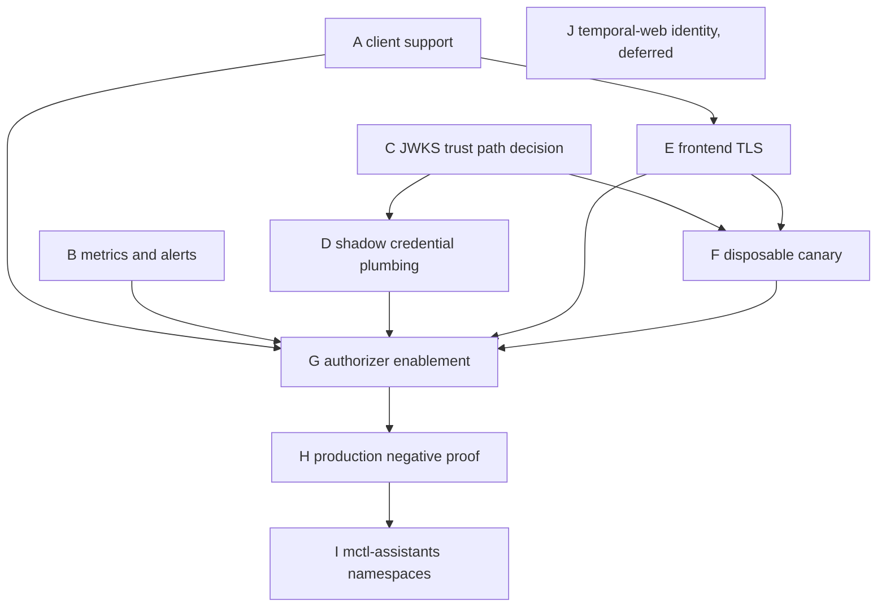

# Temporal client authentication and authorization (issues #2456, #2469)

Status: inventory and decision record only. Nothing in this document changes
runtime behaviour. Every credential, SDK, Vault, ESO, TLS, authorizer,
namespace and observability change is a separate, independently approved
DevLoop issue (see "Downstream issue breakdown"). Decision: `docs/adr/0003-temporal-client-authz.md`.

## Recommendation (spike #2469)

**Verdict: `BLOCKED`** for any TLS, credential or authorizer phase.

Outcome labels: `BLOCKED_NO_ACCESS`, `BLOCKED_JWT_SEMANTICS`,
`READY_FOR_SEPARATE_CLIENT_SUPPORT_PROPOSAL` (node A only; it is env-gated
and inert when unset). `VERIFIED_INVENTORY` applies to the GitOps-desired
state only, not to the running cluster.

Why it follows from the table below:

- Running server image, rendered config, registered namespaces and connected
  clients are `BLOCKED_NO_ACCESS`: no read-only path from this run reaches
  the `temporal` namespace.
- Source at `v1.31.0` shows the stock claim mapper does **not** validate
  `iss`. ADR 0003 decision 5 (pinned issuer) cannot be enforced by the
  server; the signing key and JWKS source are the only issuer control.
- Audience is enforced only when `global.authorization.audience` is
  non-empty, and only if `aud` is present in the token. Proof on a canary
  is still required.
- The stock key provider fetches JWKS with `http.Get` and system trust
  roots. There is no CA-file option and no file/pinned-key option. The only
  in-cluster Vault listener is plaintext. Node C (trust path) is an
  unresolved architecture decision.
- Role `worker` grants nothing on its own (see the matrix). ADR candidate
  "narrow to `worker` only if proven" is disproved.

Unresolved unknowns (explicit):

1. Live server image, `temporal-config` content, namespaces, clients.
2. kuptsi-app SDK version (`BLOCKED_NO_ACCESS`, repo/tag not readable).
3. Vault identity OIDC role template, `aud` handling, TTL,
   `verification_ttl`, and ESO `VaultDynamicSecret` GET/refresh behaviour.
4. How a pinned-key or HTTPS-with-CA JWKS source is delivered given the stock
   provider's limits.
5. Whether `enableCrossNamespaceCommands` is on in the running dynamic config
   (affects child workflow/signal across namespaces).
6. Client-side token reload behaviour in Go SDK 1.50.0 and Python 1.34.0.
7. Temporal-web identity needs `temporal-system:read` (read in every
   namespace); deferred pending admin-only risk acceptance (node J).

Companion documents: `docs/runbooks/temporal-authz-role-matrix.md`,
`docs/runbooks/temporal-auth-canary.md` and
`docs/spikes/2506-temporal-jwt-issuer.md` (issuer comparison, #2506). ADR 0003 stays `Proposed`.

## Desired state (from this repository)

- Server: chart `temporal` 1.2.0, server 1.31.0, `replicaCount: 1`
  (`platform-gitops/bootstrap/templates/data/temporal.yaml`). No
  `global.tls` and no `global.authorization` in the values: plaintext gRPC on
  7233, no authorizer.
- Boundary today: NetworkPolicy `allow-temporal-ingress`
  (`infra-components/data/temporal/networkpolicy.yaml`) only. It limits who
  can connect, not what a connected client may do.
- Temporal namespaces registered by `tenant-namespace-job.yaml`: `kuptsi`
  (7d), `mctl-agents` (30d).

### Client inventory

| Client | Source of truth | Temporal namespace |
|---|---|---|
| mctl-api | `bootstrap/templates/mctl-platform/mctl-api.yaml` | mctl-agents |
| mctl-agents-worker (control) | `services/admins/mctl-agents-worker/values.yaml` | mctl-agents |
| mctl-agents-worker-exec | `services/admins/mctl-agents-worker-exec/values.yaml` | mctl-agents |
| mctl-agents-worker-implement | `services/admins/mctl-agents-worker-implement/values.yaml` | mctl-agents |
| kuptsi-app + `temporal-worker` sidecar | `services/labs/kuptsi-app/values.yaml` | kuptsi |
| temporal-web | `bootstrap/templates/data/temporal-web.yaml` | all (default kuptsi) |
| namespaces bootstrap Job, admintools | `tenant-namespace-job.yaml`, chart | system |

Any caller not in this table is a finding. Absence of evidence below means
"not observed", never "absent".

## Live evidence inventory

Observed 2026-11-08 by the Tier 2 implementer agent for #2469. `VERIFIED_SOURCE`
means desired state in Git or upstream source at a pinned tag; it does not
prove the running state. A row is `VERIFIED_LIVE` only when an operator
supplies dated command output. Pinned gitops commit: `c50deaf29700e625906d6f6887fae5c7d0386c14`.

| Item | Source | Version | Observed | Status |
|---|---|---|---|---|
| Server chart and appVersion | `platform-gitops/bootstrap/templates/data/temporal.yaml`@mctl-gitops@c50deaf | chart 1.2.0, app 1.31.0 | 2026-11-08, agent | VERIFIED_SOURCE |
| No `global.tls`, `server.config.tls`, `global.authorization`, `internalFrontend` in desired values | same file@mctl-gitops@c50deaf | n/a | 2026-11-08, agent | VERIFIED_SOURCE (desired state only) |
| Running server image | `kubectl -n temporal get deploy -o wide` | unknown | not run: no cluster access | BLOCKED_NO_ACCESS |
| Rendered frontend config | `kubectl -n temporal get cm temporal-config -o yaml` | unknown | not run: no cluster access | BLOCKED_NO_ACCESS |
| Registered namespaces | `temporal operator namespace list` (read-only) | unknown | not run: no cluster access | BLOCKED_NO_ACCESS |
| Namespaces intended by bootstrap Job | `platform-gitops/infra-components/data/temporal/tenant-namespace-job.yaml`@mctl-gitops@c50deaf | admin-tools 1.31.0 | 2026-11-08, agent | VERIFIED_SOURCE (kuptsi, mctl-agents) |
| Connected clients | frontend logs / `temporal_request` metrics (no scrape exists today) | unknown | not run: no cluster access | BLOCKED_NO_ACCESS |
| Network boundary | `platform-gitops/infra-components/data/temporal/networkpolicy.yaml`@mctl-gitops@c50deaf: port 7233 from `mctl-api` ns, `admins-mctl-agents-worker{,-exec,-implement}`, `labs-kuptsi-app`; intra-namespace open | n/a | 2026-11-08, agent | VERIFIED_SOURCE |
| Client tags | mctl-api 4.154.0 (`bootstrap/templates/mctl-platform/mctl-api.yaml`), mctl-agents 1.117.0 and kuptsi-app 0.2.27 (`services/{admins,labs}/.../values.yaml`), temporalio/ui 2.49.1 (`bootstrap/templates/data/temporal-web.yaml`), all @mctl-gitops@c50deaf; `mctl_get_service_config` agrees for the two services | as listed | 2026-11-08, agent | VERIFIED_SOURCE |
| Clients send no token or TLS env | the same values files@mctl-gitops@c50deaf | n/a | 2026-11-08, agent | VERIFIED_SOURCE (desired state only) |
| SDK: mctl-api | `go.mod` at `mctlhq/mctl-api@4.154.0` | go.temporal.io/sdk v1.50.0, api v1.63.5 | 2026-11-08, agent | VERIFIED_SOURCE |
| SDK: mctl-agents | `uv.lock` and `pyproject.toml` at `mctlhq/mctl-agents@1.117.0` (`temporalio==1.34.0`) | temporalio 1.34.0 | 2026-11-08, agent | VERIFIED_SOURCE |
| SDK: kuptsi-app | repo `ghcr.io/mctlhq/kuptsi-app` image; source repo/tag 0.2.27 not readable with the available credentials (404) | unknown | 2026-11-08, agent | BLOCKED_NO_ACCESS |
| Chart 1.2.0 supports `server.config.tls` and `server.config.authorization` | `temporalio/helm-charts` tag `temporal-1.2.0`, `charts/temporal/values.yaml` lines 95-140 and `templates/server-configmap.yaml` lines 48-57 | chart 1.2.0 | 2026-11-08, agent | VERIFIED_SOURCE. The chart key is `server.config.authorization`; it renders under `global.authorization` |
| Chart 1.2.0 `internalFrontend` | `charts/temporal/values.yaml` line 302 declares `server.internal-frontend` (disabled by default); not exercised | chart 1.2.0 | 2026-11-08, agent | VERIFIED_SOURCE (key exists; behaviour BLOCKED_NO_ACCESS until canary) |
| Default-authorizer role per API | role/RPC matrix in `docs/runbooks/temporal-authz-role-matrix.md` | server v1.31.0 source | 2026-11-08, agent | VERIFIED_SOURCE |
| `iss` validation | matrix doc, JWT section: not validated by stock code | v1.31.0 | 2026-11-08, agent | VERIFIED_SOURCE (not enforced) |
| Non-empty `aud` enforcement | matrix doc: enforced when `global.authorization.audience` is non-empty | v1.31.0 | 2026-11-08, agent | VERIFIED_SOURCE; runtime proof BLOCKED_JWT_SEMANTICS until canary T2 |
| Vault listener plaintext | `platform-gitops/bootstrap/templates/core-infra/vault.yaml`@mctl-gitops@c50deaf: `tls_disable = 1`, chart 0.28.1 | Vault chart 0.28.1 | 2026-11-08, agent | VERIFIED_SOURCE |
| JWKS fetch with trusted TLS or a pinned key | matrix doc: stock provider is `http.Get` with system roots, no CA/file option | v1.31.0 | 2026-11-08, agent | VERIFIED_SOURCE (constraint); trust path undecided (node C) |
| Vault identity OIDC role/key template, `aud`, TTL, `verification_ttl` | Vault identity secrets engine docs plus canary repro in the matrix doc | Vault server version unobserved | 2026-11-08, agent | BLOCKED_JWT_SEMANTICS |
| ESO `VaultDynamicSecret` with GET token endpoint and refresh | canary repro in the matrix doc | ESO version unobserved | 2026-11-08, agent | BLOCKED_JWT_SEMANTICS |
| Effect of `temporal-system:read` for the UI | matrix doc: read in every namespace plus cluster reads | v1.31.0 | 2026-11-08, agent | VERIFIED_SOURCE |

Role strings accepted by the stock claim mapper: `read`, `write`, `worker`,
`admin` (case-insensitive); cluster scope is `temporal-system:<role>`. They
are NOT `reader`/`writer`/`system:admin`. Anything unrecognised maps to no
role.

## Downstream issue breakdown (DAG)

Each node is a separate DevLoop issue and proposal. None is approved by this
document. A node starts only after its own human approval. The standing rule:
never remove `allow-temporal-ingress`; it stays as defense in depth.

Common SLO check for B-I: over 24h before and after the phase, production
DevLoop and kuptsi workflow success rate must not drop and p95 task latency
must stay within the tolerance recorded in the issue.

| Node | Repo | Owner | Mandatory review | Approval gate | Rollback | Sequencing | Stop condition |
|---|---|---|---|---|---|---|---|
| A. Client support: `TEMPORAL_TOKEN_FILE` (re-read at least every 5 min, bearer header), `TEMPORAL_TLS_CA_FILE`, `TEMPORAL_TLS_SERVER_NAME`; inert when unset; never log token | mctl-api, mctl-agents, kuptsi-app | each repo owner | code review per repo; security review | admin approval per repo | revert release; unset env | first; no deploy dependency | any behaviour change with env unset; token appears in logs |
| B. Frontend metrics scrape and authz alerts with promtool tests | mctl-gitops | platform | platform review | admin approval | revert PR | before G | alert not testable with promtool |
| C. JWKS trust path decision: HTTPS with CA in the server's system trust store, or a pinned-key distribution; `http://` is rejected | mctl-gitops (ADR) | platform security | architecture review | admin approval | none (decision only) | before D, F | no authenticated option reviewed |
| D. Credential plumbing in shadow: Vault OIDC key and roles, ESO, mounts, inventory rows in `agent-credential-delivery.md`, CI validator | mctl-gitops | platform | security review | admin approval | delete roles and ExternalSecrets | after C | ESO cannot deliver a refreshed token |
| E. Frontend TLS: internal CA, certificate, client CA distribution | mctl-gitops | platform | security review | admin approval | revert `server.config.tls`, restore plaintext | after A | any client fails to connect in shadow |
| F. Disposable canary per `temporal-auth-canary.md` | mctl-gitops | platform | security review | admin approval | delete the canary release and namespace | after C, E, matrix | any T1-T11 fails; aud or iss not demonstrable |
| G. Authorizer enablement | mctl-gitops | platform | security review | admin approval and maintenance window | revert `global.authorization`, then TLS | after A, B, D, E, F | SLO regression; unexpected denial |
| H. Production negative proof; update NetworkPolicy header | mctl-gitops | platform | security review | admin approval | as G | after G | any negative test passes through |
| I. `mctl-assistants*` namespaces and identities | mctl-gitops | platform | security review | admin approval | delete namespaces and roles | after H | isolation test T8 fails |
| J. temporal-web identity | mctl-gitops | admin | admin-only risk acceptance | explicit admin risk acceptance | remove the token | deferred | risk not accepted |

Node J note: the stock UI needs `temporal-system:read`, which the matrix
shows allows read (describe, list, query, history) in every namespace plus the
cluster read APIs. `TEMPORAL_DISABLE_WRITE_ACTIONS` is a UI control only. It is
deferred until an admin explicitly accepts a read-all UI or a narrower design
is separately reviewed.
