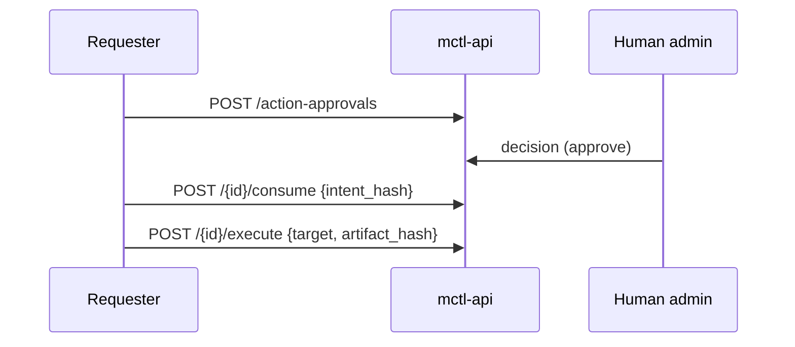

# Proposed content: action-approvals-execution-bound

> **Apply to:** `mctl-docs/docs/api/index.md` (UPDATE - append section)
> **Source:** mctl-api@5962165, 3487bdb (supporting: 0196447, df43377)
> **version-status:** unverified, see commit SHA

---

After (new section to append):

````markdown
## Action approvals

An action approval is a human-approved, single-use permission for one runtime side effect. The requester spends it once (`consume`), then marks it done once (`execute`).

| Route | Purpose |
|---|---|
| `POST /api/v1/action-approvals` | Request approval of one side effect. Idempotent per (requester, idempotency key); the key may be in the body or the `Idempotency-Key` header and they must agree. |
| `GET /api/v1/action-approvals` | List requests. |
| `GET /api/v1/action-approvals/{id}` | Read one request (lazy expiry applies to `state`). |
| `POST /api/v1/action-approvals/{id}/consume` | Body `{intent_hash}`. Atomic `approved` -> `consumed`, only while the stored `intent_hash` matches and the request has not expired. |
| `POST /api/v1/action-approvals/{id}/execute` | Body `{target, artifact_hash}`. Atomic `consumed` -> `executed`. |

The server computes `intent_hash`; a sent value that differs is refused with 400 `intent_hash_mismatch`. A caller who may not act gets 403 `approval_requester_forbidden`; another requester's request answers 404.



### Agent run tokens

A **scoped** agent run token bound to an execution (see [Agent scopes](/security/authorization#agent-scopes-and-run-tokens)) may use these routes with these limits:

- It requests, reads, lists, consumes and marks executed only its own requests for its own execution (and its own work item when one is named). Naming another `execution_id` or `work_item_id` gives 403 `approval_requester_forbidden`.
- It never requests a `mctl-agents-approve` gate.
- It may read and mark executed its execution's `mctl-agents-approve` grant, but never consume it.
- An unscoped token gets none of this, even when bound to an execution.

Governed MCP tool calls made with an agent run token also need a receipt bound to the token's execution; a token bound to no execution has no valid receipt.

### DevLoop approve without a grant

A DevLoop approve decision that carries a binding to a grant is refused when no grant exists (409 grant missing; 503 when no store is available) rather than falling back to an unbound approval. <TODO: confirm with author of 3487bdb - exact error codes and the route this applies to>
````

---
