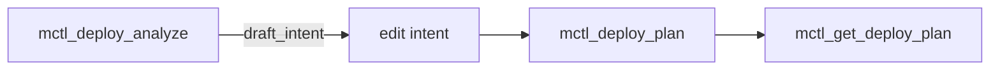

## Deploy analysis and planning

### `mctl_deploy_analyze`

Statically analyzes a GitHub repository at a pinned commit and answers whether it can be deployed as-is (Tier 0: a Dockerfile in the repository). Nothing is cloned, built or run.

| Parameter | Required | Description |
|---|---|---|
| `tenant` | yes | Workspace you are a member of |
| `repository` | yes | `owner/name` |
| `revision` | yes | Full 40-character lowercase commit SHA. Branches and tags are refused |
| `dockerfile` | no | Path relative to repo root (default `Dockerfile`) |
| `context` | no | Build context (default `.`) |

Possible answers:

- `draft_intent` — a schema-valid draft DeployIntent.
- `needs_input` — values mctl will not guess: `runtime.port`, `runtime.healthPath`, `metadata.service`.
- `supported=false` — with a machine-readable reason. This is a normal answer, not an error.

Only repositories bound to the tenant, and readable by mctl's GitHub credential, are analyzed. Read failures are reported as errors, never as "unsupported".

### `mctl_get_repo_binding`

Lists the services (tenant and service) built from a GitHub repository, limited to tenants you can see. An unreadable GitOps checkout is an error, never an empty list.

### `mctl_deploy_plan` and `mctl_get_deploy_plan`

`mctl_deploy_plan` compiles an immutable **preview** deploy plan for a DeployIntent (for example the edited `draft_intent`). Planning writes no gitops file and touches no cluster; it returns a plan id, a unified diff, the preview host, the digest and the approval the plan will need. Secret references are redacted.

- `environment=production` is refused (`prod_requires_promote`), and so is a service that does not exist yet (`onboard_requires_preview_onboard`).
- The same intent yields the same digest. Pass `idempotency_key` to get the stored plan back on retry (`replayed=true`).
- Plans expire (`ttl_seconds`, 60 to 86400, default 1800). Approval is a later step and is not granted by planning.

`mctl_get_deploy_plan` reads a stored plan by id (`dpl_…`); only members of the plan's tenant and platform admins can see it.

