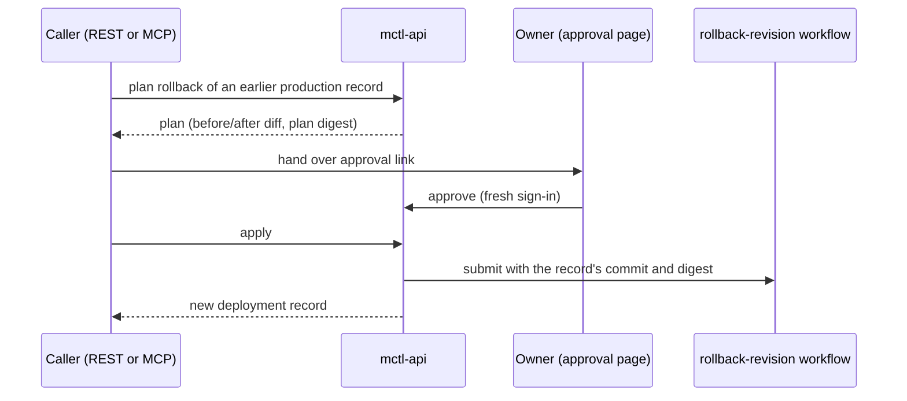

# Proposed content: deploy-rollback-owner-grant

> **Apply to:** `mctl-docs/docs/guides/rollbacks.md` (UPDATE) and `mctl-docs/docs/mcp/tools-reference.md` (UPDATE)
> **Source:** mctl-api@8780f98, mctl-api@46694e8, mctl-gitops@c6f49f9, mctl-gitops@ad65613, mctl-gitops@7fc94b6, mctl-gitops@6fd14e2, mctl-gitops@8d09fb4
> **version-status:** unverified, see commit SHA

---

## Part 1: `docs/guides/rollbacks.md` (UPDATE)

The page body was not read. Replace any section describing a production rollback as a tag-only change, and add the following sections after the introduction.

### Before (expected stale content, confirm when applying)

```markdown
<TODO: quote the current rollback section of docs/guides/rollbacks.md; it likely describes changing the image tag without an approval step>
```

### After

````markdown
## Rolling back production

A production rollback restores production to the state of one earlier production deployment. It is a governed change: it needs an owner's approval before anything is applied.

1. **Plan.** You ask for a rollback of an earlier production deployment record. The commit and image digest are taken from that record. They are never taken from your request, so a rollback cannot point at an image production did not run before.
2. **Approve.** An owner approves the plan on the fresh-login approval page. The approval is a `deploy.apply` grant bound to the digest of the plan, so it covers exactly the change shown.
3. **Apply.** The apply submits the `rollback-revision` workflow with the record's commit and digest, and writes a new deployment record that names the restored deployment. The reconciler then compares the digest that actually ran.



### Plan a rollback

REST: `POST /api/v1/deploy/rollback`. MCP: `mctl_rollback_deployment`.

```bash
curl -X POST https://api.mctl.ai/api/v1/deploy/rollback \
  -H "Authorization: Bearer $MCTL_TOKEN" \
  -H "Content-Type: application/json" \
  -d '<TODO: confirm request body with author of 8780f98>'
```

::: warning Who can plan
Only tenants in the platform's promote list (currently `admins`) can plan a production rollback, the same as for promotion. <TODO: confirm wording and whether this is user-visible with author of 8780f98>
:::

### The generic rollback route refuses production

The ungoverned `rollback-revision` route refuses production deployments with the error `rollback_requires_grant`. For workspaces in the promote list it refuses whatever record is named, because that workflow rewrites the values file production runs from. Use the governed rollback above instead.

## What a rollback restores

Services can pin an image digest under the image tag, and the digest decides what runs. The `rollback-service` workflow therefore restores the tag and the digest together.

The digest comes from the optional `target_digest` input, or otherwise from the digest the tag had in the values file's own history. The workflow refuses, instead of rolling back by tag alone, when:

- the service pins a digest but none can be found to restore;
- the tag is bound to two different digests in history, or a digest in history is shared with another tag (an explicit `--digest` known to history is still accepted);
- the supplied digest disagrees with history;
- the file has several image blocks;
- the history cannot be read or is longer than the limit (the older part would be unseen).

A service whose values file pins no digest keeps the tag-only behaviour. A service on a floating tag such as `latest` is refused.
````

---

## Part 2: `docs/mcp/tools-reference.md` (UPDATE)

### Before

```markdown
<TODO: quote the neighbouring deploy tools section where the entry will be inserted>
```

### After (insert in the deploy tools section)

````markdown
### `mctl_rollback_deployment`

Plans a rollback of production to the state of an earlier production deployment record. Commit and digest come from the record. Applying needs an owner's `deploy.apply` grant, decided on the approval page. Only promote-list tenants (currently `admins`) may plan. REST equivalent: `POST /api/v1/deploy/rollback`. See [Rollbacks](/guides/rollbacks).

Parameters: `<TODO: confirm with author of 8780f98>`
````

---
