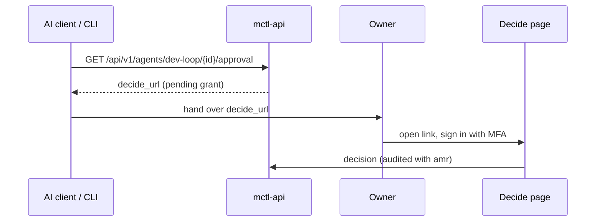

# Proposed content: devloop-decide-page-mfa

> **Apply to:** `mctl-docs/docs/security/authorization.md`, `mctl-docs/docs/mcp/tools-reference.md`, `mctl-docs/docs/guides/gitops-workflows.md` (all UPDATE)
> **Source:** mctl-api@00e9fd9, 2019361, 0453322, 236b60e, 0469fed, 46569d7, 8972d94, 193abba, ad889ab, 7ae67a4, cb1e91d
> **version-status:** unverified, see commit SHA

---

## Part 1: `docs/security/authorization.md` (UPDATE)

### Before

```markdown
<TODO: quote the current section on approvals, if any; otherwise insert a new section at the end>
```

### After

````markdown
## Approving DevLoop proposals

A DevLoop proposal is approved only on the **decide page**. The page requires a fresh sign-in and a second factor: it refuses a decision unless the ID token's `amr` includes `mfa`, and it records the reported `amr` in its audit entry.

The reason: the owner's identity token is also held by AI clients (CLI tokens, chat connectors), so a call with that bearer token cannot be told apart from the owner's own click. Only the page proves a person decided.

A bearer caller that tries to approve gets `403 decide_page_required`. The same applies to running the `mctl-agents-approve` operation directly (MCP `mctl_trigger_approve`). When the grant is pending, the page is enabled and the caller may see the grant, the response includes a `decide_url`. Denying a grant is not blocked by this rule. Re-sending an already approved grant decides nothing and is still allowed.



### Decide links

A `decide_url` is bound to exactly one grant, its context digest and its content digest. The page requires the exact shapes: grant `aar_` plus 32 hex characters, digests `sha256:` plus 64 hex characters. A link cut short, for example by terminal line wrapping, is refused with an error page before any sign-in. Copy the whole link.

::: tip For AI clients
Tool descriptions tell the model to hand the `decide_url` to the owner and never to call `mctl_approve_dev_loop` on its own or relay a chat "yes".
:::

<TODO: confirm with author of 2019361 whether `DEVLOOP_BEARER_APPROVE_ENABLED` (operator break-glass, restores bearer approve for a human admin; agent credentials stay refused) should be public.>
````

---

## Part 2: `docs/mcp/tools-reference.md` (UPDATE)

### After (add to the entries for `mctl_approve_dev_loop` and `mctl_trigger_approve`)

````markdown
::: warning Approval is decided on the decide page
These tools do not decide a pending DevLoop approval. A bearer call returns `403 decide_page_required`, with a `decide_url` when available. Hand the `decide_url` to the owner. See [Authorization](/security/authorization#approving-devloop-proposals).
:::
````

---

## Part 3: `docs/guides/gitops-workflows.md` (UPDATE)

### After (new subsection)

````markdown
## Approval pages

Release and deploy approvals are decided on a web page by an owner.

- **Deploy approval page:** links the source revision, the GitOps commit and the preview host (https only, opened in a new tab) so you can compare them with what you expect. For a preview plan the page says the decision applies to "the preview above"; for a promotion or rollback it says "production, as shown above". The final page ends with "You can close this tab."
- **Release approval page:** links the tag commit to its GitHub commit and the version to its GitHub release notes. Values that do not validate stay plain text.

<TODO: confirm with author of 193abba / 7ae67a4 what the release page says about ledger enforcement today; wording changed twice and must not be documented until settled.>
````

---
