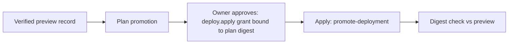

# Proposed content: preview-promote-and-onboard

> **Apply to:** `mctl-docs/docs/guides/previews.md` (UPDATE) and `mctl-docs/docs/mcp/tools-reference.md` (UPDATE, one entry)
> **Source:** mctl-api@db4dda2, a3cc4b3, 5067b9d, d45bcc4, 5786817
> **version-status:** unverified, see commit SHA

---

## `docs/guides/previews.md` (UPDATE)

### Before

```markdown
<TODO: quote the end of the current page; new sections are appended after existing content>
```

### After (append)

````markdown
## Promote a verified preview to production

You can promote a preview that has been verified. Promotion is planned from the preview's deployment record, so production gets exactly the image the preview ran.

A preview record can be promoted when it was submitted, its run succeeded, it was observed healthy, and its image digest is recorded. The tag and digest come from that record; no request field names them.



1. **Plan.** `POST /api/v1/deploy/promote` or MCP `mctl_promote_deployment`. The plan pins the tag and digest in the service's production values.
2. **Approve.** An owner approves through the existing request-approval flow. A grant is never self-approved.
3. **Apply.** The `promote-deployment` operation verifies the digest still matches the tag, pins both, and runs the health gate.

```bash
curl -X POST https://api.mctl.ai/api/v1/deploy/promote \
  -H "Authorization: Bearer $MCTL_TOKEN" \
  -H "Content-Type: application/json" \
  -d '<TODO: confirm request body with author of db4dda2>'
```

::: warning Who can promote
Only the `admins` tenant can promote until the MCP gateway policy exists.
:::

### Refusals

- `deploy_apply_not_reproducible`: the production values changed after the plan was made, so the owner's before/after diff no longer applies. This stops an older, still-valid grant from rolling production back to an older image. Plan again.

### Digest check

After a promotion finishes, the platform records `digest_check` once on the promotion record: `match` when production ran the same digest as the preview, `mismatch` when it differs, `unverified` when production reported no digest. If the preview cannot be read the check is retried, never skipped.

## Onboard a preview from a DeployIntent

A service with no `values.yaml` in gitops used to be refused at plan time with `onboard_requires_preview_onboard`. It is now planned as `action=onboard`.

- The values are compiled from the DeployIntent over a platform base: the image built from source under `ghcr.io/<org>/<service>` and the registry pull secret.
- The stored plan shows redacted values and is bound by its digest. An owner must approve it.
- Apply rebuilds the values from the stored intent and refuses unless they render exactly to the approved result.
- A plan whose compiled values are too large for `preview-deploy` is refused at plan time. The decide page asks the same reproducibility question as apply.
- The audit record names the compiled values by length and keeps only their hash, since real secret paths are inside.

<TODO: confirm with author of d45bcc4 the user-facing request shape (DeployIntent fields) and the plan response.>
````

### `docs/mcp/tools-reference.md` entry (add)

````markdown
### `mctl_promote_deployment`

Plans promotion of a verified preview deployment record to production. Tag and digest come from the record. Applying needs an owner's `deploy.apply` grant. Only the `admins` tenant may promote. REST: `POST /api/v1/deploy/promote`. See [Preview Environments](/guides/previews). Parameters: `<TODO: confirm with author of db4dda2>`
````

---
