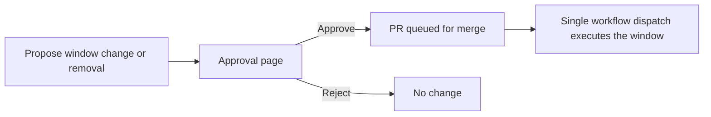

# Proposed content: release-windows-guide

> **Apply to:** `mctl-docs/docs/guides/release-windows.md` (CREATE)
> **Source:** mctl-api@549d77b, 41b91c1, 9ad4b97, 452afeb, c50e7a7, 95cb4d2, 7aca28e
> **version-status:** unverified, see commit SHA

---

```md
---
title: Release windows
---

# Release windows

Release (sync) windows control when a tenant's applications may sync. Changes to windows go through an approval flow and are executed by the platform.

## Lifecycle



1. **Propose.** Use the sync-window MCP tools, available on the shared portal MCP surface. To remove a window, call `mctl_propose_window_removal`.
2. **Approve.** The approver opens the decide page. Approving **queues the PR for merge**; the page says so explicitly. Removal proposals use a removal-aware page and the work-item kind `release.window.removal`.
3. **Execute.** An approved window is executed through a single workflow dispatch. If the client disconnects mid-run, state is still settled, and expired claims are reported.

## Listing windows

The listing shows the **configured** windows, not only the ones currently in effect.

## Proposing a removal

<!-- TODO: confirm with author of 9ad4b97: argument names and response shape -->
```json
{
  "tool": "mctl_propose_window_removal",
  "arguments": { "<TODO>": "confirm with author of 9ad4b97" }
}
```

## REST routes

<TODO: confirm with author of 549d77b / 9ad4b97: route paths for execute and removal>

## Related
- [MCP tools reference](/mcp/tools-reference)
- [API index](/api/)
```

---

## Patch: `docs/mcp/tools-reference.md` (UPDATE)

Before: no sync-window entries.

After (append under the appropriate section):
```md
### Release windows
- Sync-window tools: <TODO: confirm tool names with author of 41b91c1>
- `mctl_propose_window_removal` — propose removing a release window; see [Release windows](/guides/release-windows).
```
